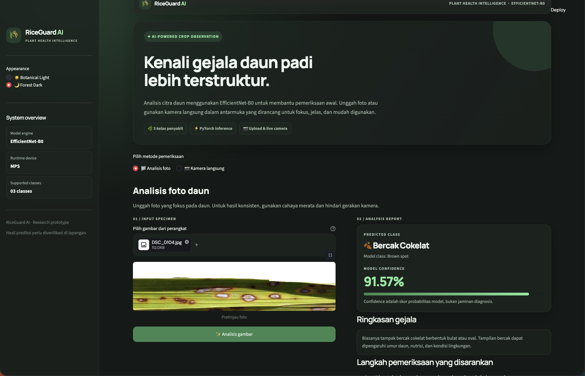
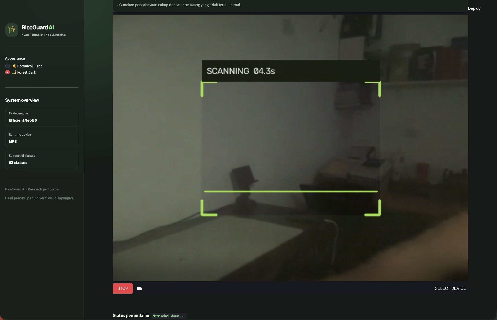
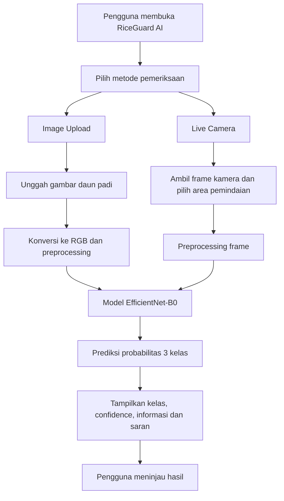

# 🌾 RiceGuard AI

**RiceGuard AI** adalah aplikasi berbasis *deep learning* untuk mengklasifikasikan penyakit daun padi dari gambar. Aplikasi dibuat menggunakan **Python, PyTorch, EfficientNet-B0, dan Streamlit** dengan dua pilihan pemeriksaan: unggah gambar dan kamera langsung.

> RiceGuard AI merupakan prototipe klasifikasi awal. Hasil prediksi bukan diagnosis agronomis final dan perlu diverifikasi melalui pemeriksaan tanaman di lapangan.

## Tampilan Aplikasi

### 1. Mode gelap— Botanical dark input gambar



### 2. Mode Gelap — Forest Dark visual camera



> Letakkan dua screenshot aplikasi asli pada folder `docs/screenshots/` dengan nama `1.png` dan `2.png`. Ambil screenshot setelah aplikasi dijalankan agar gambar README sesuai dengan tampilan aktual.

## Fitur Utama

- **Image Upload:** pengguna mengunggah gambar daun padi berformat JPG, JPEG, atau PNG untuk dianalisis.
- **Live Camera:** pengguna dapat memindai daun secara langsung melalui kamera menggunakan Streamlit WebRTC.
- **Klasifikasi 3 kelas:** Bacterial leaf blight, Brown spot, dan Leaf smut.
- **Informasi hasil:** aplikasi menampilkan kelas prediksi, nilai confidence, penjelasan singkat, dan saran pemeriksaan.
- **Tema antarmuka:** pilihan Botanical Light dan Forest Dark dengan desain glassmorphism.

## Alur Program



### Ringkasan proses

1. Pengguna membuka aplikasi dan memilih **Image Upload** atau **Live Camera**.
2. Pada mode upload, gambar daun dibaca dan dikonversi ke RGB. Pada mode kamera, frame video diproses pada area pemindaian.
3. Gambar menjalani preprocessing menggunakan transformasi validasi/pengujian, termasuk penyesuaian ukuran dan normalisasi.
4. Tensor gambar diteruskan ke model **EfficientNet-B0** yang bobot terlatihnya dimuat dari checkpoint.
5. Model menghasilkan skor untuk tiga kelas. Softmax digunakan untuk memperoleh probabilitas, kemudian kelas dengan probabilitas tertinggi dipilih.
6. Aplikasi menampilkan prediksi, confidence, deskripsi kelas, dan saran pemeriksaan.

## Kelas yang Didukung

| Label model | Nama tampilan |
|---|---|
| `Bacterial leaf blight` | Hawar Daun Bakteri |
| `Brown spot` | Bercak Cokelat |
| `Leaf smut` | Penyakit Leaf Smut |

Model hanya mengklasifikasikan tiga kelas tersebut. Model tidak melakukan deteksi lokasi bercak atau segmentasi area penyakit.

## Teknologi

- Python
- PyTorch
- EfficientNet-B0 (timm)
- Streamlit
- Streamlit-WebRTC
- OpenCV
- Pillow

## Struktur Proyek

```text
riceguard-ai/
├── app.py
├── requirements.txt
├── README.md
├── configs/
├── src/
│   ├── data/
│   │   └── transforms.py
│   └── models/
│       └── efficientnet.py
├── scripts/
├── checkpoints/          # lokal, tidak diunggah ke GitHub
├── dataset/              # lokal, tidak diunggah ke GitHub
└── docs/
    └── screenshots/      # screenshot README
```

Sesuaikan contoh struktur di atas dengan direktori yang benar-benar tersedia pada repository.

## Instalasi dan Menjalankan Aplikasi

### 1. Clone repository

```bash
git clone https://github.com/USERNAME/riceguard-ai.git
cd riceguard-ai
```

### 2. Buat virtual environment

```bash
python3 -m venv .venv
source .venv/bin/activate
```

### 3. Instal dependensi

```bash
python -m pip install --upgrade pip
pip install -r requirements.txt
```

### 4. Siapkan checkpoint model

Letakkan file checkpoint hasil training pada lokasi berikut:

```text
checkpoints/best_model.pth
```

Checkpoint tidak disertakan dalam repository apabila dikecualikan oleh `.gitignore`. Unduh atau siapkan file tersebut secara terpisah sebelum menjalankan aplikasi.

### 5. Jalankan Streamlit

```bash
python -m streamlit run app.py
```

Buka alamat lokal yang ditampilkan Streamlit, biasanya `http://localhost:8501`.

## Catatan Penggunaan

- Untuk hasil yang lebih baik, gunakan foto daun yang fokus, terang, dan memperlihatkan gejala dengan jelas.
- Pada Live Camera, izinkan akses kamera di browser dan pastikan koneksi mendukung WebRTC.
- Nilai confidence menunjukkan tingkat keyakinan relatif model terhadap prediksi, bukan jaminan bahwa prediksi benar.
- Prediksi sebaiknya dibandingkan dengan pengamatan beberapa daun/tanaman dan dikonfirmasi oleh petugas atau ahli pertanian.

## Pengembangan

RiceGuard AI dikembangkan sebagai proyek pembelajaran dan prototipe klasifikasi citra penyakit daun padi. Pengembangan selanjutnya dapat mencakup penambahan variasi dataset, evaluasi pada data lapangan yang lebih besar, dan validasi oleh ahli pertanian.

---

**RiceGuard AI** · EfficientNet-B0 · PyTorch · Streamlit
